# ggwas: Modern GWAS Visualizations

Abstract

The ggwas package provides a comprehensive, ggplot2-based toolkit for
visualizing genome-wide association study results. It covers a range of
GWAS plots, from standard Manhattan and QQ plots to novel visualizations
like genome-wide heatmaps, enrichment overlays, and multi-trait
comparisons. All functions return ggplot objects, making them fully
composable with the tidyverse graphics ecosystem. This vignette
demonstrates the main functionality with worked examples.

## Introduction

Genome-wide association studies (GWAS) generate large amounts of summary
statistics that require effective visualization for interpretation and
publication. The standard tools in R (`qqman`, `CMplot`) rely on base R
graphics and offer limited customization. Modern genomics workflows
benefit from a plotting system that integrates with ggplot2. This allows
layered customization, journal-specific theming, and composition of
multi-panel figures.

`ggwas` was designed with three goals:

1.  **Broad coverage**: 21 plot types in one package, including views
    not found in other GWAS plotting packages.
2.  **Publication-ready defaults**: sensible colors, proper axis
    formatting, and built-in journal themes so plots look good without
    tweaking.
3.  **Performance at scale**: smart downsampling handles 10M+ variant
    datasets without manual intervention.

The package reads output from PLINK, REGENIE, GCTA, GEMMA, and any
generic tab-separated file. All plot functions return standard ggplot
objects, so you can add layers, override themes, or combine panels with
`patchwork` exactly as you would with any other ggplot.

### Place in a Bioconductor workflow

`ggwas` is the plotting step after association testing and annotation.
It takes its genomic inputs as Bioconductor objects:

- **Variants** as a `data.frame` of summary statistics or as a `GRanges`
  ([`as_gwas_data()`](https://bczech.github.io/ggwas/reference/as_gwas_data.md)
  and every plot function accept both;
  [`as_granges()`](https://bczech.github.io/ggwas/reference/as_granges.md)
  converts back).
- **Gene models** as `GRanges`, `TxDb`
  (*[GenomicFeatures](https://bioconductor.org/packages/3.23/GenomicFeatures)*)
  or `EnsDb`
  (*[ensembldb](https://bioconductor.org/packages/3.23/ensembldb)*)
  objects, for gene tracks, locus plots and nearest-gene labels.
- **Annotation regions** (enhancers, eQTLs, regions to highlight) as
  `GRanges` or `GRangesList`. Files in BED, GFF/GTF, bigWig or bigBed
  format are read with `rtracklayer::import()`
  (*[rtracklayer](https://bioconductor.org/packages/3.23/rtracklayer)*).
- **Chromosome lengths and naming** as `Seqinfo` objects
  (*[GenomeInfoDb](https://bioconductor.org/packages/3.23/GenomeInfoDb)*),
  taken for example from a `TxDb` or a `BSgenome`.

### Related Bioconductor packages

Several Bioconductor packages draw GWAS plots. They differ in scope and
in the graphics system they build on:

| Package | GWAS plots | Graphics | Main input |
|----|----|----|----|
| *[ggmanh](https://bioconductor.org/packages/3.23/ggmanh)* | Manhattan (also binned), QQ | ggplot2 | data.frame, GRanges, GDS |
| *[GWASTools](https://bioconductor.org/packages/3.23/GWASTools)* | Manhattan, QQ | base R | p-value and chromosome vectors |
| *[karyoploteR](https://bioconductor.org/packages/3.23/karyoploteR)* | Manhattan on a karyotype ideogram | base R | GRanges |
| *[ggbio](https://bioconductor.org/packages/3.23/ggbio)* | Manhattan (`plotGrandLinear()`) | ggplot2 | GRanges |
| *[Gviz](https://bioconductor.org/packages/3.23/Gviz)* | p-values as a data track next to gene tracks | grid | GRanges, TxDb |
| *[snpStats](https://bioconductor.org/packages/3.23/snpStats)* | QQ (`qq.chisq()`) | base R | chi-squared statistics |
| **ggwas** | 21 types (below) | ggplot2 | data.frame, GRanges, TxDb, EnsDb, Seqinfo |

`ggwas` overlaps with these packages on the Manhattan and QQ plots. It
adds Miami, locus zoom with LD and gene track, circular, enrichment and
multi-trait Manhattan plots, PheWAS, colocalization, fine-mapping,
genetic correlation and architecture plots, SNP density karyograms, and
journal themes, all returning ggplot objects. Use
*[Gviz](https://bioconductor.org/packages/3.23/Gviz)* or
*[karyoploteR](https://bioconductor.org/packages/3.23/karyoploteR)* when
you need many stacked genomic data tracks; use `ggwas` when the
association results are the main subject of the figure.

## Getting started

### Installation

``` r

# From Bioconductor (once accepted)
if (!requireNamespace("BiocManager", quietly = TRUE))
    install.packages("BiocManager")
BiocManager::install("ggwas")

# Development version from GitHub
pak::pak("bczech/ggwas")
```

### Reading data

The fastest way to load GWAS results is
[`read_gwas_table()`](https://bczech.github.io/ggwas/reference/read_gwas_table.md),
which auto-detects common column naming conventions (CHR/CHROM/#CHROM,
BP/POS/GENPOS, P/PVALUE/LOG10P, etc.):

``` r

library(ggwas)
library(ggplot2)
library(GenomicRanges)
library(GenomeInfoDb)
library(rtracklayer)

data(example_gwas)
example_gwas
#> A gwas_data object: 8,000 variants across 22 chromosomes
#>   Min p-value: 1.19e-14
#>   Lambda GC:   3.996
#>   Columns:     CHR, BP, SNP, P, BETA, SE, A1, A2, AF
```

The result is a `gwas_data` object: a data.frame with validated columns
and a custom print method showing key QC metrics at a glance. The
example data are simulated, with positions drawn within GRCh38
chromosome lengths.

Variants stored as a `GRanges` work the same way.
[`as_granges()`](https://bczech.github.io/ggwas/reference/as_granges.md)
converts a `gwas_data` object, and any plot function accepts the result:

``` r

gr <- as_granges(example_gwas)
gr
#> GRanges object with 8000 ranges and 7 metadata columns:
#>             seqnames    ranges strand |         SNP          P      BETA
#>                <Rle> <IRanges>  <Rle> | <character>  <numeric> <numeric>
#>   rs2678525       16  80841579      * |   rs2678525 0.18988331  -0.01723
#>   rs8451246        5  80011524      * |   rs8451246 0.05264044  -0.02073
#>   rs7069507       12  34577737      * |   rs7069507 0.04506835   0.01575
#>   rs4824759       12  16869788      * |   rs4824759 0.00680649  -0.10267
#>   rs7209949        7  38647669      * |   rs7209949 0.56527788  -0.00012
#>         ...      ...       ...    ... .         ...        ...       ...
#>   rs7761398       11  23750379      * |   rs7761398   0.115608   0.05872
#>   rs7135121        3  69639436      * |   rs7135121   0.929757   0.04248
#>   rs6635611       18  40340076      * |   rs6635611   0.788155   0.06943
#>   rs6641483       13  74927676      * |   rs6641483   0.174590   0.00629
#>   rs5502842       20  14803036      * |   rs5502842   0.291328   0.06330
#>                    SE          A1          A2        AF
#>             <numeric> <character> <character> <numeric>
#>   rs2678525   0.01314           G           T    0.2522
#>   rs8451246   0.01070           G           T    0.3089
#>   rs7069507   0.00786           T           A    0.3404
#>   rs4824759   0.03794           C           A    0.1418
#>   rs7209949   0.00021           T           C    0.3506
#>         ...       ...         ...         ...       ...
#>   rs7761398   0.03732           C           G    0.1445
#>   rs7135121   0.48192           T           C    0.3549
#>   rs6635611   0.25838           G           A    0.3425
#>   rs6641483   0.00463           T           A    0.2657
#>   rs5502842   0.05999           C           T    0.1301
#>   -------
#>   seqinfo: 22 sequences from an unspecified genome; no seqlengths
```

For specific tools, dedicated readers handle format quirks
automatically:

``` r

gwas <- read_gwas_table("results.txt")       # auto-detect
gwas <- read_plink_assoc("results.assoc")    # PLINK
gwas <- read_plink_linear("results.assoc.linear")
gwas <- read_regenie("results.regenie")      # REGENIE (handles LOG10P)
gwas <- read_gcta_mlma("results.mlma")       # GCTA
gwas <- read_gemma("results.assoc.txt")      # GEMMA
```

You can also pass any `data.frame` directly, specifying non-standard
column names:

``` r

manhattan_plot(my_df, chr = "chrom", bp = "position", p = "pval")
```

## Core plots

### Manhattan plot

The Manhattan plot is the most common GWAS visualization. Each point is
a tested variant, plotted by genomic position (x) against its
association strength as -log10(p-value) (y). Chromosomes alternate in
color for visual separation.

**How to interpret:** Look for “towers” of points rising above the
genome-wide significance line (red dashed, p = 5×10⁻⁸). Each tower is a
locus with evidence of true association. Isolated points above the line
are worth investigating but may be artifacts. A broad signal spanning
multiple chromosomes equally (rather than discrete peaks) can indicate
unresolved population stratification. Check the QQ plot in that case.

``` r

manhattan_plot(example_gwas)
```

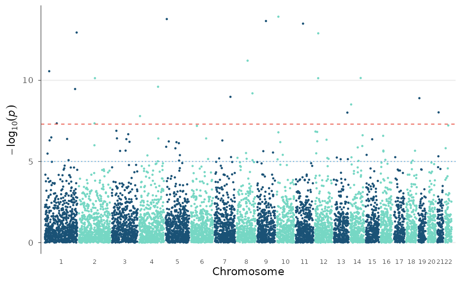

Label the strongest signals and switch to a different palette:

``` r

manhattan_plot(
  example_gwas,
  label_top_n = 5,
  colors = gwas_palette("vibrant")
)
```

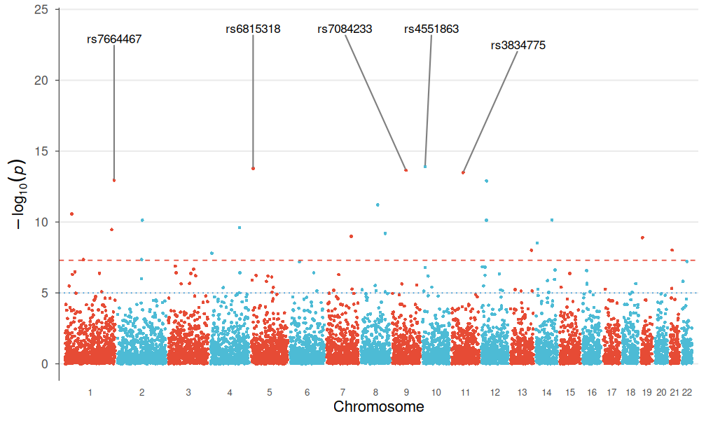

#### Broken y-axis for extreme p-values

When a few loci have extremely low p-values (e.g., 1e-50), they compress
the rest of the plot. `y_truncate` breaks the y-axis: the region between
the two values is cut out, and a break symbol (//) marks the transition:

``` r

# Add extreme p-values for demonstration
gwas_extreme <- example_gwas
gwas_extreme$P[1:2] <- c(1e-50, 1e-30)

# Cut the region between 15 and 45 on the -log10(p) scale
manhattan_plot(gwas_extreme, y_truncate = c(15, 45), label_top_n = 3)
```

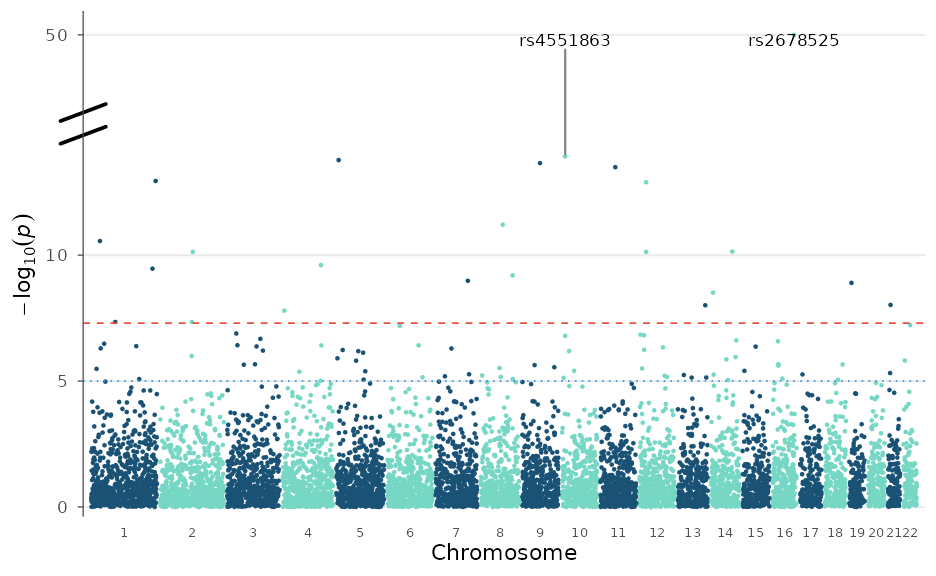

A single value auto-detects the resume point from the data:

``` r

manhattan_plot(gwas_extreme, y_truncate = 15, label_top_n = 3)
```

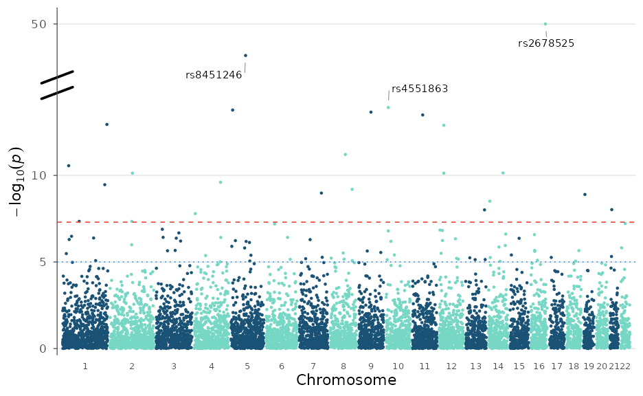

#### Significance thresholds

The genome-wide and suggestive significance lines are fully
customizable. The default 5e-8 assumes a standard human GWAS with ~1M
independent tests, but the correct threshold depends on the number of
variants, correction method, and organism:

``` r

# Bonferroni for 500k SNPs
manhattan_plot(example_gwas, genome_wide = 0.05 / 500000, suggestive = 1e-4)
```

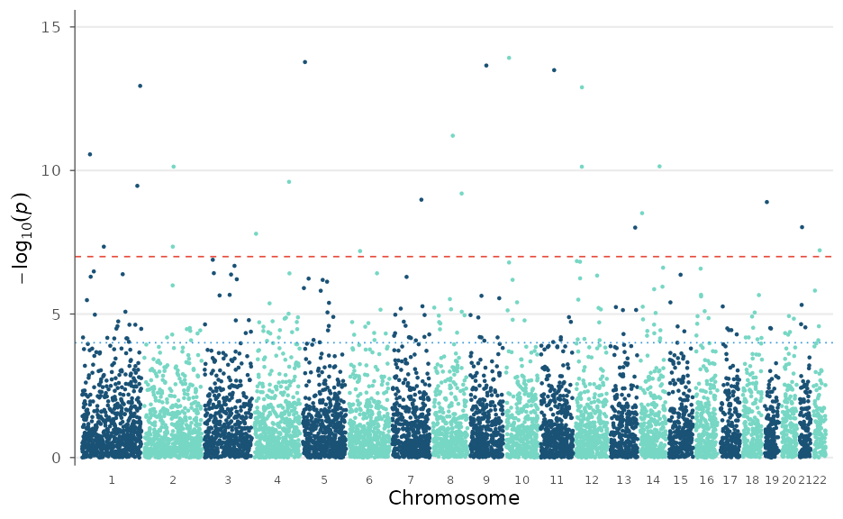

``` r

# No threshold lines
manhattan_plot(example_gwas, genome_wide = NULL, suggestive = NULL)
```

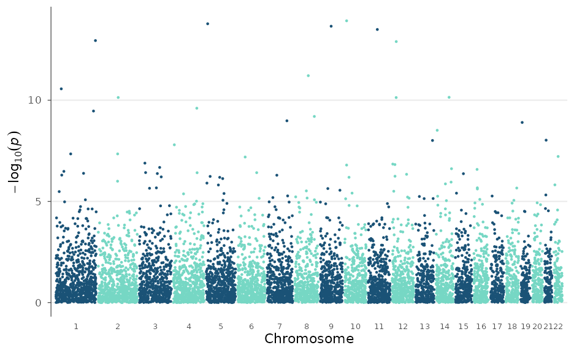

#### Effect-size confidence bound

For datasets with extreme p-values (e.g. biobank GWAS), small p-values
do not always imply large, robust effects: rare alleles with perfect
case/control assortment can produce astronomical p-values despite
negligible or unreplicable effects. `y_metric = "beta_min"` plots the
lower bound of the effect-size confidence interval: \|beta\| - 2\*SE.
Variants whose CI overlaps zero are excluded, revealing only those with
large, robust effects:

``` r

set.seed(42)
n <- 5000
sim <- data.frame(
  CHR = sample(1:22, n, replace = TRUE),
  BP = sample(1:250e6, n),
  SNP = paste0("rs", seq_len(n)),
  P = runif(n)^3,
  BETA = rnorm(n, 0, 0.02),
  SE = abs(rnorm(n, 0.03, 0.005))
)
real <- sample(n, 15)
sim$P[real] <- 10^(-runif(15, 5, 12))
sim$BETA[real] <- rnorm(15, 0, 0.5)
sim$SE[real] <- runif(15, 0.01, 0.03)
fake <- sample(setdiff(seq_len(n), real), 10)
sim$P[fake] <- 10^(-runif(10, 8, 15))
sim$BETA[fake] <- rnorm(10, 0, 0.05)
sim$SE[fake] <- runif(10, 0.08, 0.2)

sim_gwas <- as_gwas_data(sim)

library(patchwork)
p1 <- manhattan_plot(sim_gwas) + ggtitle("Standard: -log10(p)")
p2 <- manhattan_plot(sim_gwas, y_metric = "beta_min", label_top_n = 3) +
  ggtitle("Effect confidence: |beta| - 2*SE")
p1 / p2
```

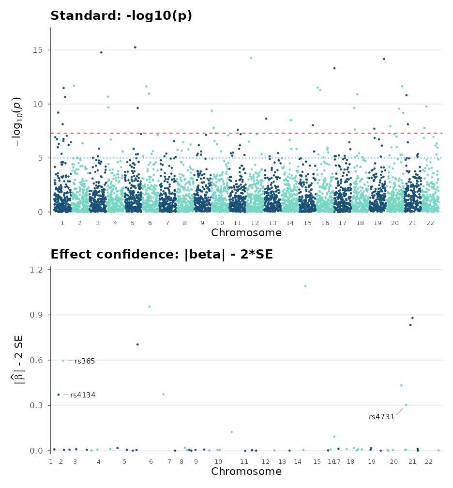

Many hits visible in the standard plot disappear in the
effect-confidence view because their large SE makes the confidence
interval overlap zero, a hallmark of artifacts from rare variants.

#### Palette and theme variations

The same Manhattan plot can look very different with alternative
palettes and themes, which is useful when matching journal style guides:

``` r

manhattan_plot(example_gwas, colors = gwas_palette("lancet")) + theme_science()
```

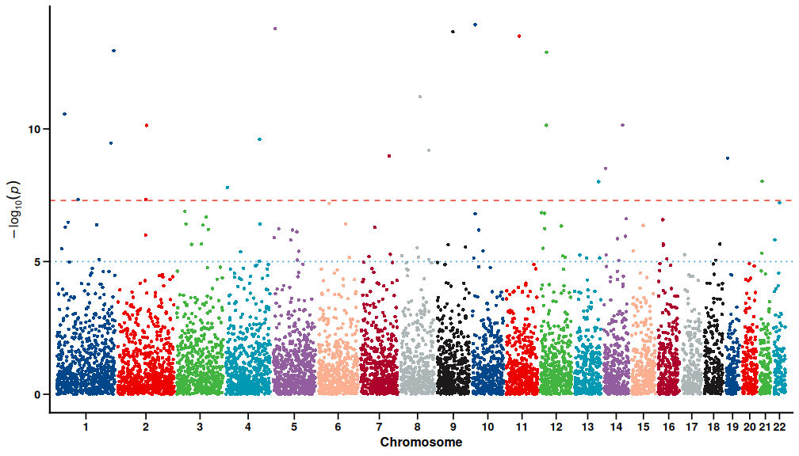

``` r

manhattan_plot(example_gwas, colors = gwas_palette("nejm")) + theme_cell()
```

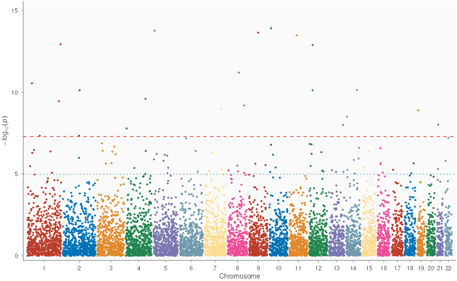

### QQ plot

The quantile-quantile plot compares observed p-value distribution
against the expectation under the null hypothesis.

**How to interpret:** Points should follow the diagonal closely in the
lower left (bulk of non-associated variants) and only deviate upward in
the tail (true signals). If points lift off the diagonal early and
uniformly, that indicates genomic inflation, either population
stratification or cryptic relatedness in your sample. The grey band is
the 95% confidence interval under the null: points inside it are
consistent with no association. λ_GC \> 1.05 in a well-powered GWAS with
polygenic signal is expected; λ_GC \> 1.2 without a clear polygenic
explanation warrants investigation.

``` r

qq_plot(example_gwas, show_lambda = TRUE, ci = 0.95)
```

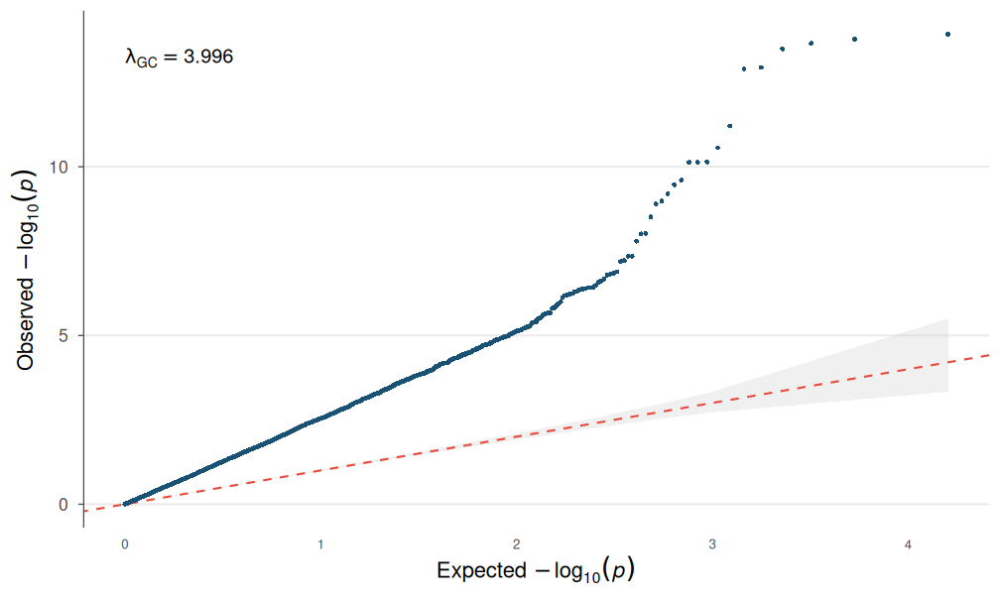

Stratifying by minor allele frequency helps diagnose whether inflation
is driven by rare variants (common in imputed data) or is uniform:

``` r

example_gwas$MAF_bin <- cut(
  example_gwas$AF,
  breaks = c(0, 0.05, 0.2, 0.5),
  labels = c("Rare (<5%)", "Low (5-20%)", "Common (>20%)")
)
qq_plot(example_gwas, group = "MAF_bin")
```

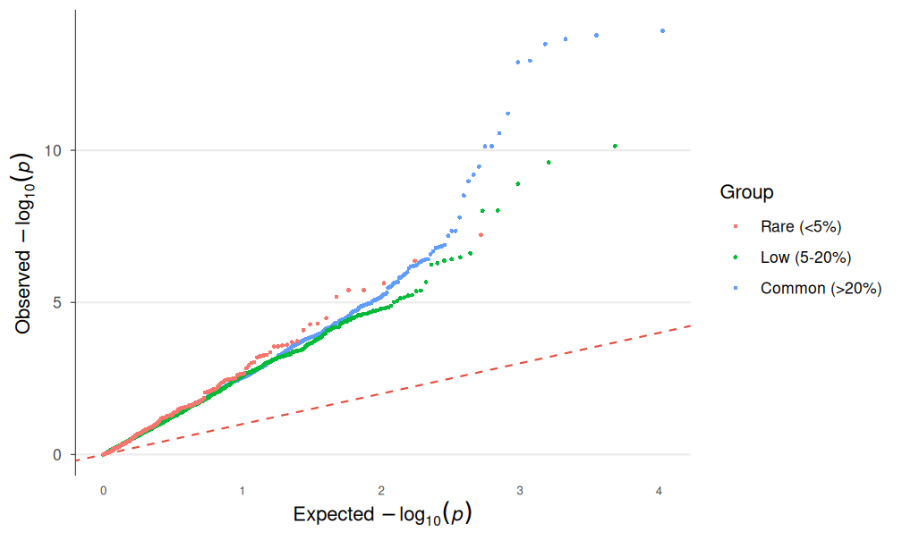

### Miami plot

The Miami plot mirrors two Manhattan plots vertically: one pointing up,
one pointing down. This is the standard way to compare discovery and
replication cohorts, or two related traits, on a shared genomic
coordinate axis.

**How to interpret:** Peaks at the same genomic position in both panels
replicate across cohorts. Peaks present in only one panel may be
cohort-specific (sample composition, ancestry differences) or
underpowered in the other study. Use this for discovery/replication
comparison or for two related phenotypes (e.g., BMI vs waist-hip ratio)
to see shared loci:

``` r

miami_plot(
  example_gwas, example_gwas,
  top_title = "Discovery",
  bottom_title = "Replication"
)
```

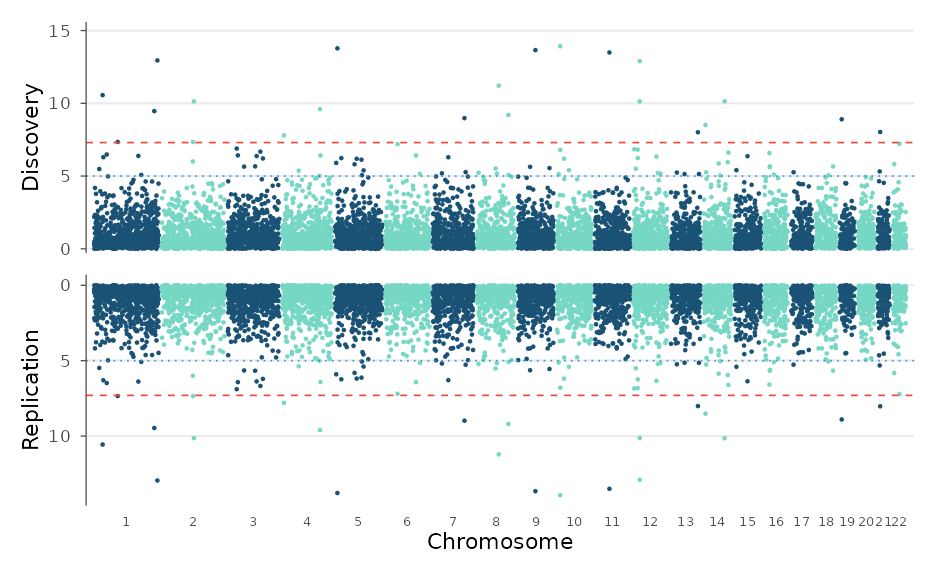

### Locus zoom

Once you identify a significant region, a locus plot shows the fine
structure of association within that locus.

**How to interpret:** The lead SNP (lowest p-value) anchors the plot.
When LD data is provided, points are colored by r² with the lead. Red
points (high LD) that also reach significance support the same
association signal, while blue points (low LD) that reach significance
independently may represent a secondary signal at the locus. The gene
track underneath shows which genes fall within the region, guiding
biological follow-up:

``` r

locus_plot(example_gwas, region = "chr1:1000000-50000000")
```

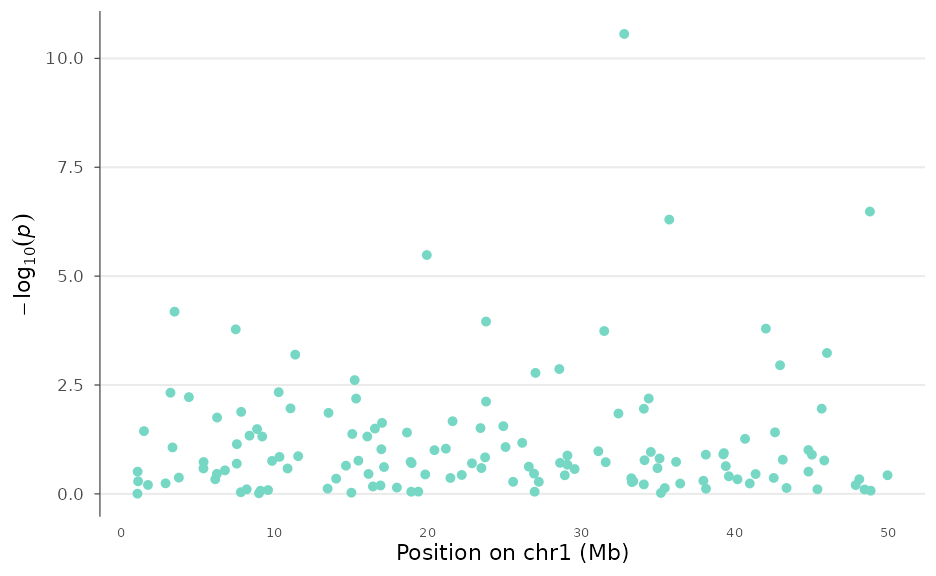

The region can also be a `GRanges` of length 1. Gene models are added
with `genes =`, as shown in Section @ref(genomic-tracks).

## Novel visualizations

### Genome-wide p-value heatmap

A compact representation of association signals across the entire
genome. The x-axis is binned genomic position, the y-axis is chromosome,
and color intensity reflects the strongest signal in each bin.

**When to use:** This works well as a supplementary overview figure. It
shows genome-wide patterns that Manhattan plots can obscure through
overplotting. Hot spots (bright tiles) across multiple chromosomes
suggest polygenicity; a single intense cluster points to one major
locus. It also handles 10M+ variant datasets without downsampling
because it pre-aggregates.

``` r

pvalue_heatmap(example_gwas, bin_size = 10e6, palette = "magma")
```

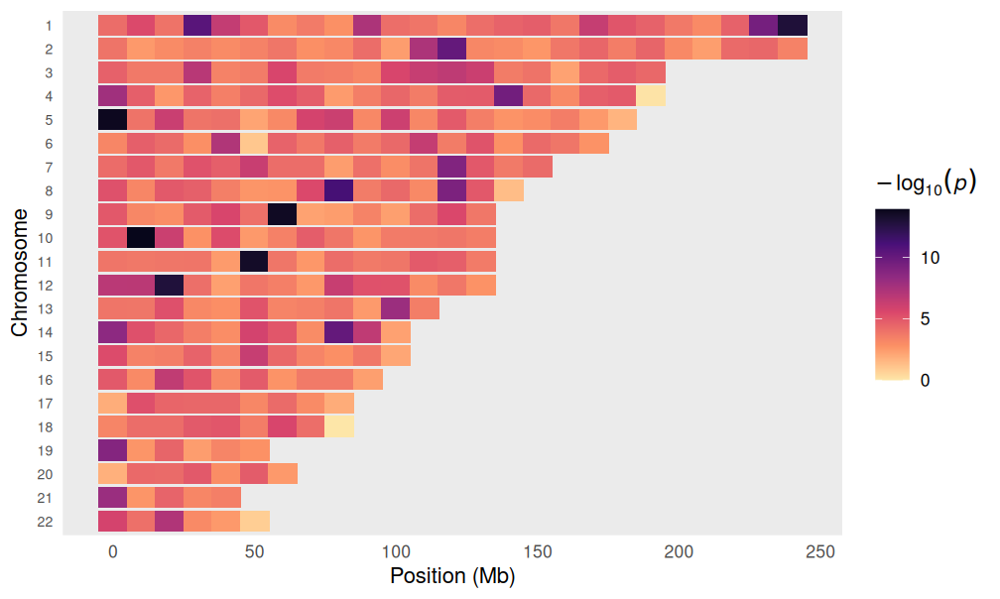

Different palettes emphasize different signal ranges:

``` r

pvalue_heatmap(example_gwas, bin_size = 10e6, palette = "viridis")
```

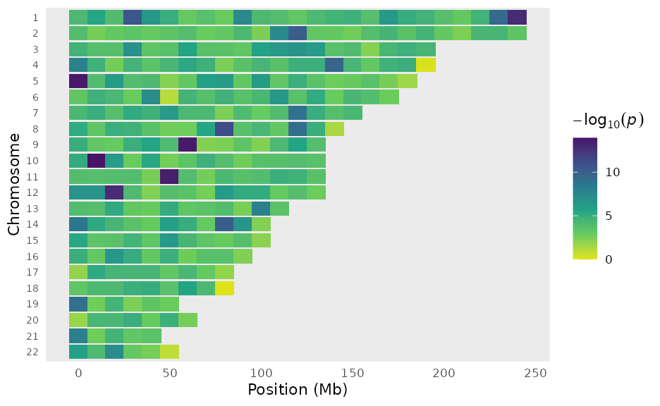

``` r

pvalue_heatmap(example_gwas, bin_size = 10e6, palette = "inferno")
```

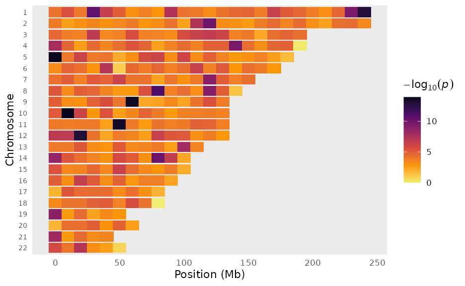

### Effect-size volcano

Unlike the RNA-seq volcano plot (which uses fold change), this plots
GWAS effect size ($`\hat{\beta}`$) against significance. You see at once
which signals are protective vs risk-increasing, and how large the
effects are relative to their statistical evidence. Points can be
colored by significance status or by chromosome:

``` r

volcano_plot(example_gwas, label_top_n = 5)
```

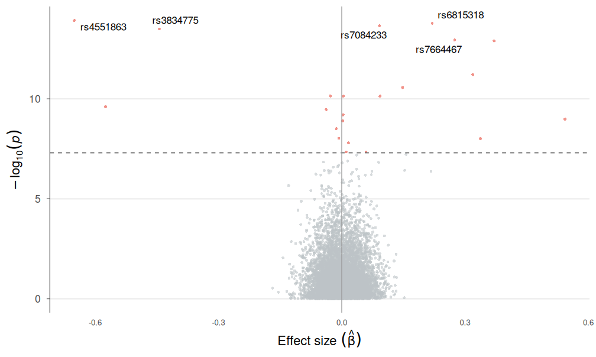

Color by chromosome instead of significance:

``` r

volcano_plot(example_gwas, label_top_n = 5, color_by = "chromosome")
```

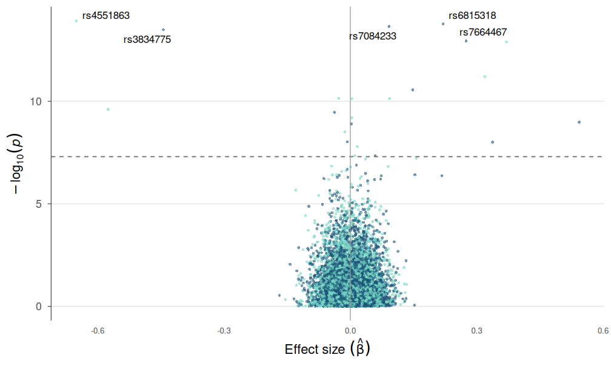

### Circular Manhattan

The circular (circos-style) Manhattan arranges chromosomes around a
ring. This layout is compact and works particularly well for multi-trait
comparisons where each trait occupies its own ring:

``` r

circular_manhattan(example_gwas, colors = gwas_palette("nature"))
```

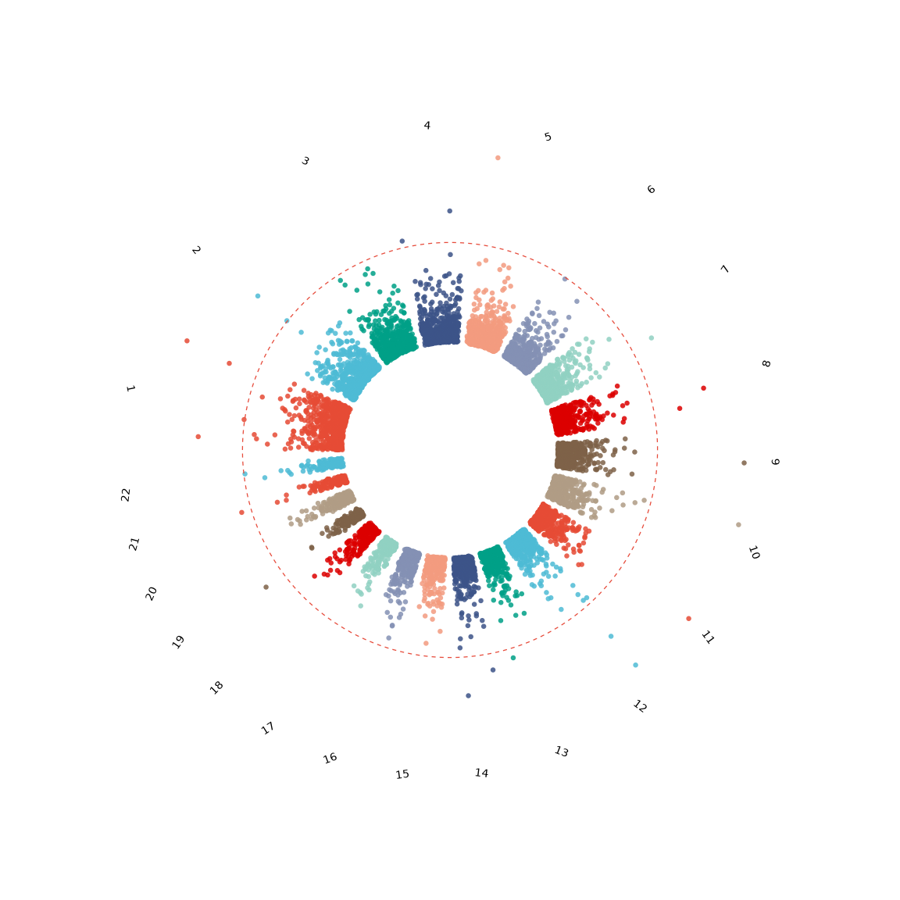

### Summary dashboard

When you need a single figure combining Manhattan, QQ, top hits table,
and p-value distribution,
[`gwas_summary()`](https://bczech.github.io/ggwas/reference/gwas_summary.md)
assembles them into a multi-panel layout with automatic tags (A, B, C,
D) suitable for supplementary figures:

``` r

gwas_summary(example_gwas)
```

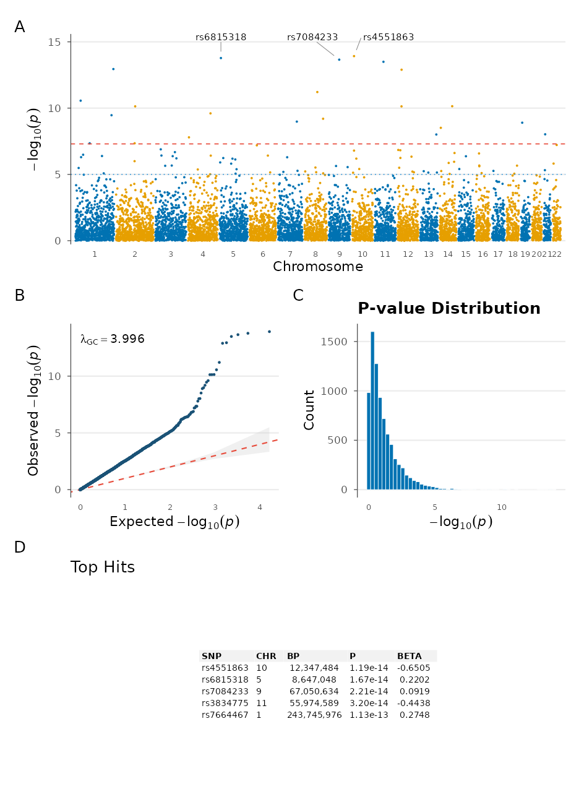

## Gene annotation and top hits

### Gene labels on peaks

In manuscripts, rs IDs are less informative than gene names.
[`manhattan_genes()`](https://bczech.github.io/ggwas/reference/manhattan_genes.md)
labels each lead SNP with its nearest gene, found with
[`GenomicRanges::distanceToNearest()`](https://rdrr.io/pkg/IRanges/man/nearest-methods.html).
Gene models come from any `GRanges`, `TxDb` or `EnsDb` object. Here we
take the GRCh38 UCSC gene models from
*[TxDb.Hsapiens.UCSC.hg38.knownGene](https://bioconductor.org/packages/3.23/TxDb.Hsapiens.UCSC.hg38.knownGene)*
and add gene symbols from
*[org.Hs.eg.db](https://bioconductor.org/packages/3.23/org.Hs.eg.db)*:

``` r

library(TxDb.Hsapiens.UCSC.hg38.knownGene)
library(org.Hs.eg.db)
txdb <- TxDb.Hsapiens.UCSC.hg38.knownGene

genes <- genes(txdb)
genes$gene_name <- mapIds(org.Hs.eg.db, keys = genes$gene_id,
                          column = "SYMBOL", keytype = "ENTREZID")
genes <- keepStandardChromosomes(genes, pruning.mode = "coarse")
genes
#> GRanges object with 35161 ranges and 2 metadata columns:
#>             seqnames              ranges strand |     gene_id   gene_name
#>                <Rle>           <IRanges>  <Rle> | <character> <character>
#>           1    chr19   58345178-58362751      - |           1        A1BG
#>          10     chr8   18386273-18401218      + |          10        NAT2
#>         100    chr20   44584896-44652252      - |         100         ADA
#>        1000    chr18   27932879-28177946      - |        1000        CDH2
#>   100008586     chrX   49551278-49568218      + |   100008586     GAGE12F
#>         ...      ...                 ...    ... .         ...         ...
#>        9990    chr15   34229784-34338060      - |        9990     SLC12A6
#>        9991     chr9 112215071-112333653      - |        9991       PTBP3
#>        9992    chr21   34180729-34371381      + |        9992       KCNE2
#>        9993    chr22   19036282-19122454      - |        9993       DGCR2
#>        9997    chr22   50523568-50526461      - |        9997        SCO2
#>   -------
#>   seqinfo: 25 sequences (1 circular) from hg38 genome
```

Because the example associations are simulated, the gene names below
only show how labelling works:

``` r

manhattan_genes(example_gwas, genes = genes, gene_p_threshold = 0.001)
```

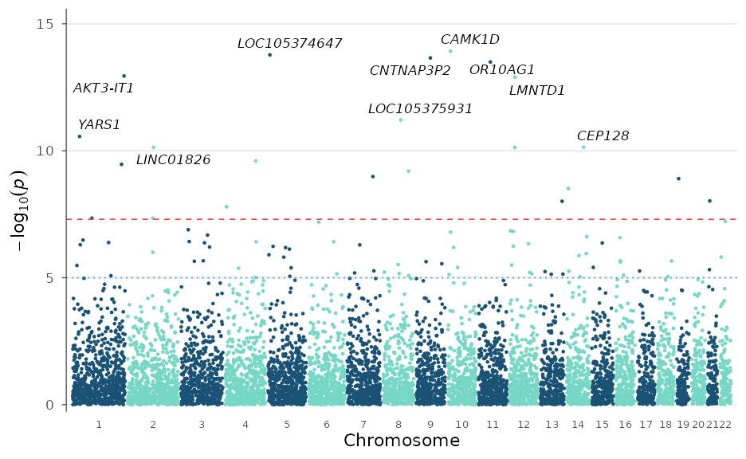

When peaks are close together, arrow-style annotations avoid label
overlap:

``` r

manhattan_genes(
  example_gwas, genes = genes,
  gene_p_threshold = 0.001,
  arrow = TRUE, label_face = "italic"
)
```

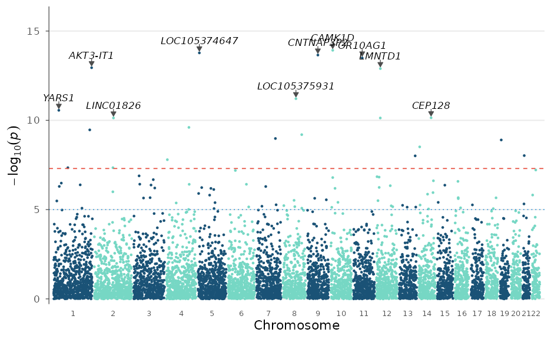

### Top hits table

[`top_hits()`](https://bczech.github.io/ggwas/reference/top_hits.md)
extracts independent lead SNPs using window-based clumping (1 Mb by
default), annotates each with an estimated cytoband, and optionally maps
to the nearest gene. The result is a plain data.frame ready for export
to a manuscript table:

``` r

top_hits(example_gwas, p_threshold = 0.001, genes = genes, n = 10)
#> === Top 10 GWAS Hits ===
#> 
#>  SNP       CHR BP        P        BETA     nearest_gene cytoband
#>  rs4551863 10   12347484 1.19e-14 -0.65050 CAMK1D       10p2    
#>  rs6815318 5     8647048 1.67e-14  0.22025 LOC105374647 5p1     
#>  rs7084233 9    67050634 2.21e-14  0.09187 CNTNAP3P2    9q7     
#>  rs3834775 11   55974589 3.20e-14 -0.44376 OR10AG1      11q6    
#>  rs7664467 1   243745976 1.13e-13  0.27479 AKT3-IT1     1q25    
#>  rs5643433 12   25442148 1.27e-13  0.37069 LMNTD1       12p3    
#>  rs8682426 8    82835070 6.14e-12  0.31901 LOC105375931 8q9     
#>  rs5807931 1    32792647 2.75e-11  0.14800 YARS1        1p4     
#>  rs4355535 14   80736074 7.20e-11 -0.02754 CEP128       14q9    
#>  rs8870315 2   123129235 7.36e-11  0.09318 LINC01826    2q13
```

### Region highlights

Mark specific genomic regions with a colored band, for example the MHC
(chr6:25-34 Mb), known risk loci from prior GWAS, or candidate regions
from linkage studies:

``` r

plt <- manhattan_plot(example_gwas)

regions <- GRanges(
  c("chr6:25000000-35000000", "chr1:5000000-30000000"),
  label = c("MHC", "1p36")
)

highlight_regions(plt, regions, color = "#FFD700", alpha = 0.2)
```

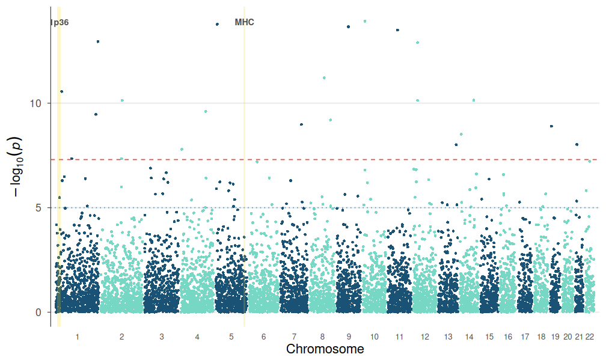

### Genomic tracks

[`gene_track()`](https://bczech.github.io/ggwas/reference/gene_track.md)
creates a standalone gene annotation panel that can be composed with any
ggwas plot using `patchwork`. It takes the region as a `GRanges` (or a
`"chr:start-end"` string) and the gene models as a `GRanges`, `TxDb` or
`EnsDb`. Genes are drawn as directional chevrons; exons from
[`exonsBy()`](https://rdrr.io/pkg/GenomicFeatures/man/transcriptsBy.html)
add the exon structure:

``` r

region <- GRanges("chr8:81800000-83900000")
exons <- exonsBy(txdb, by = "gene")

p <- locus_plot(example_gwas, region = region)
gt <- gene_track(genes, region, exons = exons, highlight_genes = "SNX16")
patchwork::wrap_plots(p, gt, ncol = 1, heights = c(0.7, 0.3))
```

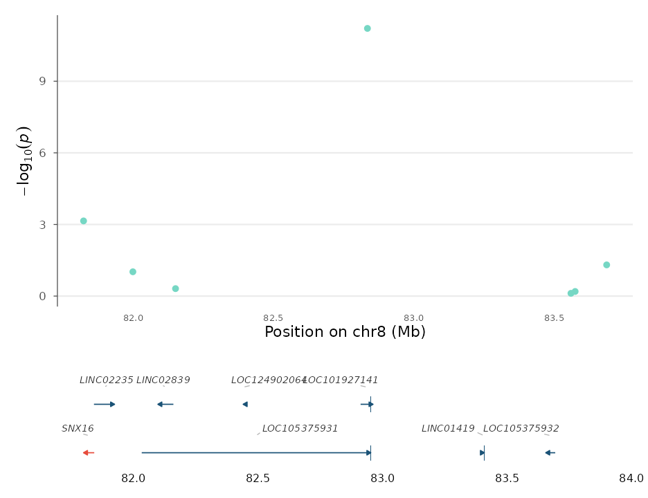

`locus_plot(..., genes = genes)` builds the same two-panel figure in one
call. A `TxDb` without symbols can also be passed directly, in which
case the genes are labelled with their Entrez IDs; an `EnsDb` carries
symbols itself.

GTF and GFF3 files are read with `rtracklayer::import()`, which handles
the coordinate conventions of each format. The gene rows are the gene
models:

``` r

gtf <- import(system.file("extdata", "example.gtf", package = "ggwas"))
gtf_genes <- gtf[gtf$type == "gene"]
gtf_genes
#> GRanges object with 4 ranges and 6 metadata columns:
#>       seqnames          ranges strand |   source     type     score     phase
#>          <Rle>       <IRanges>  <Rle> | <factor> <factor> <numeric> <integer>
#>   [1]     chr1 1000000-2000000      + |     test     gene        NA      <NA>
#>   [2]     chr1 5000000-6500000      - |     test     gene        NA      <NA>
#>   [3]     chr1 8000000-9000000      + |     test     gene        NA      <NA>
#>   [4]     chr2 3000000-4000000      + |     test     gene        NA      <NA>
#>            gene_id   gene_name
#>        <character> <character>
#>   [1] ENSG00000001       GeneA
#>   [2] ENSG00000002       GeneB
#>   [3] ENSG00000003       GeneC
#>   [4] ENSG00000004       GeneD
#>   -------
#>   seqinfo: 2 sequences from an unspecified genome; no seqlengths
gene_track(gtf_genes, "chr1:1-50000",
           exons = gtf[gtf$type == "exon"])
```

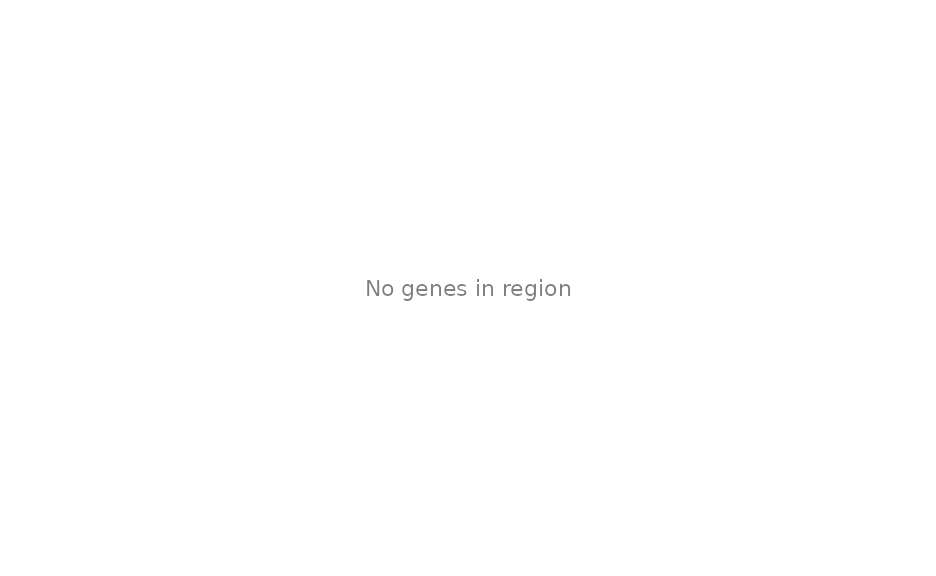

### Non-human organisms

ggwas stores chromosomes as integer codes; by default 23 = X, 24 = Y and
26 = MT, as in human data. For other organisms, pass the genome’s
`Seqinfo` to
[`set_sex_chr_map()`](https://bczech.github.io/ggwas/reference/set_sex_chr_map.md):
numbered chromosomes keep their number and the named ones (X, Y, Z, W,
MT, …) follow the last autosome. A `Seqinfo` can come from a `TxDb`,
`EnsDb` or `BSgenome` of that organism, or be built directly:

``` r

# Mouse (GRCm39): 19 autosomes, then X, Y and MT
mouse <- Seqinfo(c(1:19, "X", "Y", "MT"), genome = "GRCm39")
old <- set_sex_chr_map(mouse)
getOption("ggwas.sex_chr_map")
#>  X  Y MT 
#> 20 21 22

# Disable entirely (all chromosomes as numbers)
set_sex_chr_map(NULL)

# Restore the previous (human) mapping
set_sex_chr_map(old)
```

## Multi-study comparisons

### Multi-trait Manhattan

Pleiotropy (one variant influencing multiple traits) is pervasive in
complex genetics. Visualizing it requires overlaying GWAS results from
multiple traits on a shared genomic axis.

**How to interpret:** Diamond-shaped highlighted points are variants
reaching genome-wide significance in more than one trait simultaneously.
Peaks that appear in multiple colors at the same position suggest shared
genetic mechanisms, worth following up with formal colocalization or
Mendelian randomization:

``` r

set.seed(123)
trait2 <- example_gwas
trait2$P <- runif(nrow(trait2))^3
trait2$P[sample(nrow(trait2), 10)] <- 10^(-runif(10, 5, 10))

multitrait_manhattan(
  BMI = example_gwas,
  Height = trait2,
  colors = "nature",
  highlight_shared = TRUE
)
```

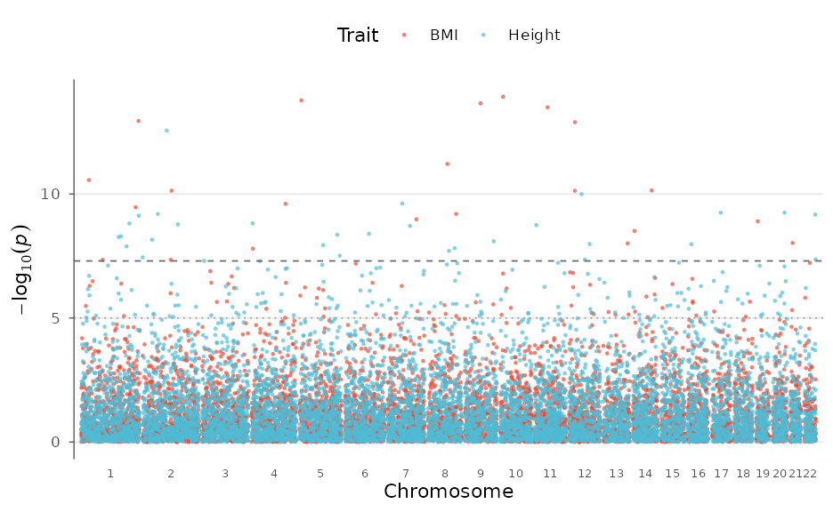

### Enrichment Manhattan

Most GWAS hits fall in non-coding regions, making functional
interpretation challenging. Overlaying genomic annotations (enhancers,
promoters, eQTLs, open chromatin from ENCODE/Roadmap) helps determine
whether signals enrich in regulatory elements relevant to the tissue of
interest.

**How to interpret:** Colored points fall within annotated functional
regions; grey background points do not. If significant peaks
preferentially overlap with one annotation type (e.g., liver enhancers
for lipid traits), that provides evidence for the regulatory mechanism
and tissue of action:

The annotations are a `GRanges` with a `category` column, or a named
`GRangesList` with one element per category. Real annotations are
usually read from BED files with `rtracklayer::import()`; here we make a
small set by hand:

``` r

annotations <- GRanges(
  c("chr1:5000000-30000000", "chr3:20000000-50000000",
    "chr5:50000000-120000000", "chr7:30000000-80000000",
    "chr11:60000000-100000000", "chr15:40000000-80000000",
    "chr19:10000000-40000000"),
  category = c("Enhancer", "Gene", "eQTL", "Gene",
               "Enhancer", "eQTL", "Gene")
)

enrichment_manhattan(example_gwas, annotations = annotations, palette = "nature")
```

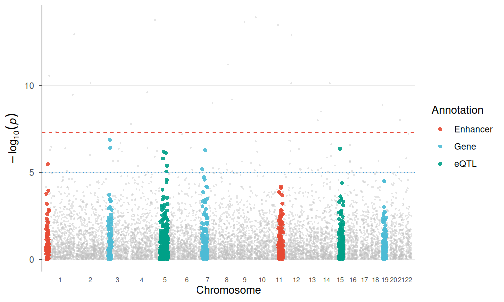

### Circular Manhattan (multi-ring)

The multi-ring layout stacks traits concentrically: each ring is an
independent GWAS, sharing the same angular coordinate system:

``` r

circular_manhattan(
  list(BMI = example_gwas, Height = trait2),
  colors = "nature", point_size = 0.6
)
```


## Post-GWAS analysis plots

### PheWAS plot

Phenome-wide association studies test one variant against hundreds or
thousands of phenotypes, common in biobank-era research (UK Biobank,
FinnGen, All of Us).

**How to interpret:** Each point is a phenotype. Phenotypes are grouped
by domain (metabolic, immune, cardiovascular, etc.) along the x-axis.
Triangles pointing up indicate risk-increasing effects; pointing down,
protective. A cluster of significant associations within one domain
suggests the variant influences a biological pathway rather than a
single trait. Isolated significant hits across multiple domains may
indicate pleiotropy or a shared confounder (e.g., BMI-mediated effects):

``` r

phewas_data <- data.frame(
  phenotype = paste0("Pheno_", 1:60),
  p = 10^(-runif(60, 0, 10)),
  category = rep(c("Metabolic", "Immune", "Neurological",
                    "Cardiovascular", "Musculoskeletal", "Other"), 10),
  beta = rnorm(60, 0, 0.3)
)

phewas_plot(phewas_data, label_top_n = 5)
```

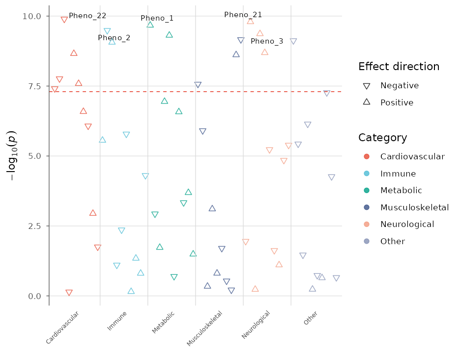

### Colocalization locus plot

Colocalization analysis asks: do a GWAS signal and an eQTL (or two GWAS
traits) share the same causal variant, or are they driven by different
variants that happen to be nearby?

**How to interpret:** The two panels share a genomic coordinate axis. If
the peak in the top panel (GWAS) aligns with the peak in the bottom
panel (eQTL), the signals likely share a causal variant, and the gene
regulated by that eQTL is a strong candidate for the GWAS hit. Offset
peaks suggest distinct causal variants in LD. This visual check
complements formal colocalization methods (coloc, eCAVIAR):

``` r

set.seed(42)
eqtl_data <- example_gwas
eqtl_data$P <- runif(nrow(eqtl_data))^2

coloc_plot(
  example_gwas, eqtl_data,
  region = "chr1:1000000-30000000",
  top_title = "GWAS", bottom_title = "eQTL"
)
```

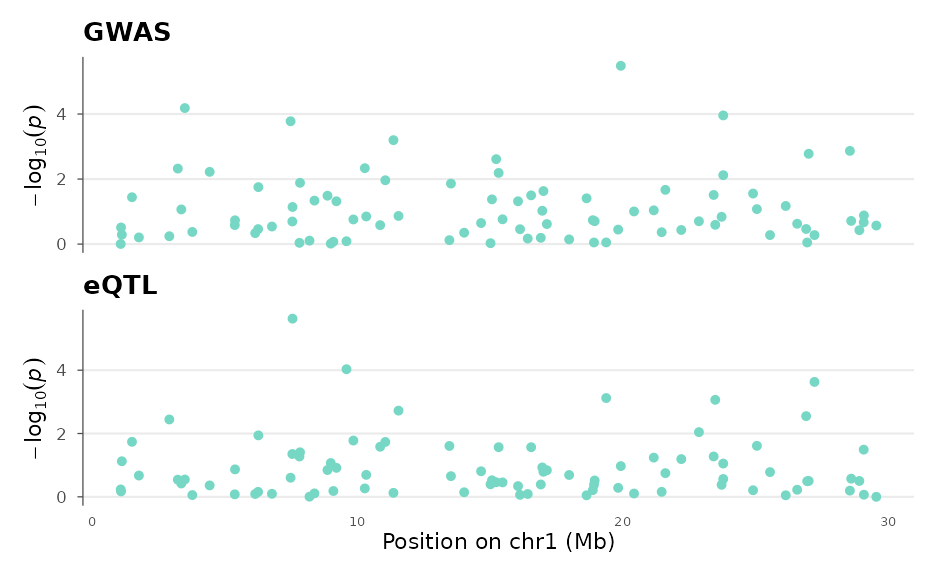

### Fine-mapping credible set

After identifying a GWAS locus, fine-mapping narrows down which variant
is most likely causal. Tools like SuSiE and FINEMAP assign each variant
a posterior inclusion probability (PIP, 0–1) and group high-PIP variants
into credible sets.

**How to interpret:** Large points have high PIP and are strong causal
candidates. Color indicates credible set membership: variants in the
same set are in LD and cannot be statistically distinguished. A locus
with one large red point (PIP \> 0.8) is well-resolved; a locus with
many medium-sized points in one set has residual uncertainty. Multiple
credible sets at one locus suggest independent signals:

``` r

fm_data <- example_gwas
fm_data$PIP <- runif(nrow(fm_data))^5
fm_data$PIP[which.min(fm_data$P)] <- 0.92
fm_data$PIP[order(fm_data$P)[2:3]] <- c(0.65, 0.4)
fm_data$credible_set <- NA_integer_
fm_data$credible_set[fm_data$PIP > 0.05] <- 1L

finemapping_plot(
  fm_data,
  region = "chr1:1000000-50000000",
  label_pip_above = 0.3
)
```

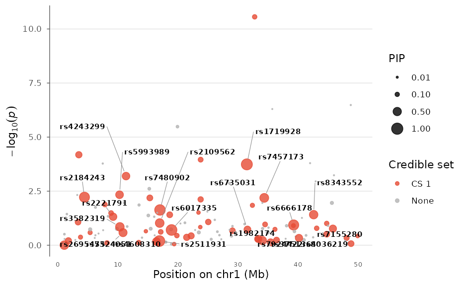

### Genetic correlation matrix

Genetic correlation (rg) measures how much the genetic basis of two
traits overlaps. It ranges from -1 (perfectly opposing genetic effects)
through 0 (independent) to +1 (shared genetic architecture). LDSC or
GREML estimate rg from GWAS summary statistics alone, without
individual-level data.

**How to interpret:** Red cells indicate traits that share risk variants
(e.g., BMI and T2D). Blue cells indicate opposing genetics (e.g., height
and T2D). Clustering reveals groups of genetically related traits. Stars
mark statistically significant correlations. This figure is essential
for understanding trait relationships in cross-trait genomics:

``` r

traits <- c("BMI", "Height", "WHR", "T2D", "CAD", "SBP", "HDL")
set.seed(123)
rg <- matrix(0, 7, 7, dimnames = list(traits, traits))
rg[lower.tri(rg)] <- runif(21, -0.6, 0.8)
rg <- rg + t(rg)
diag(rg) <- 1

genetic_correlation(rg, show_values = TRUE, palette = "RdBu")
```

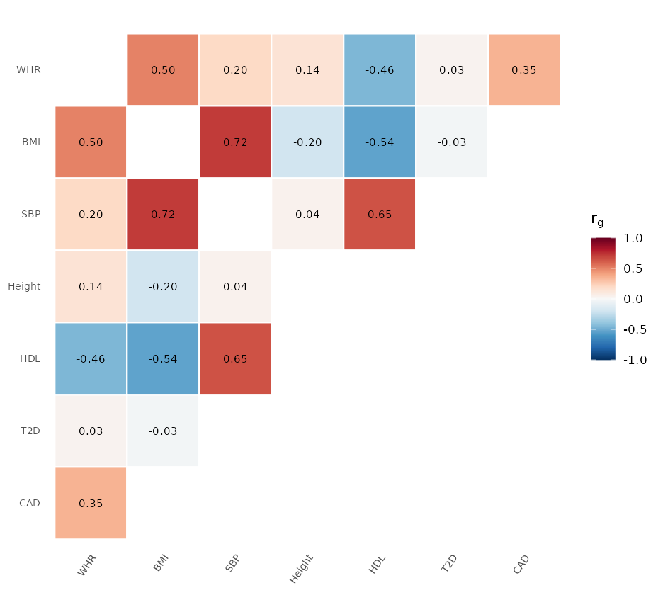

Alternative palette and without clustering:

``` r

genetic_correlation(rg, show_values = TRUE, palette = "PRGn", cluster = FALSE)
```

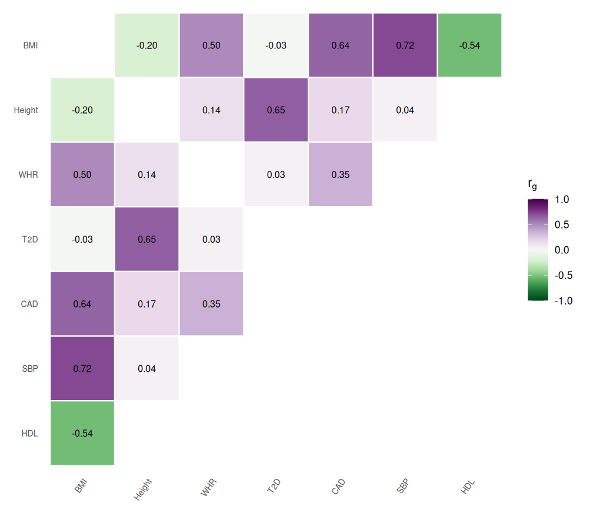

### Genetic architecture

The relationship between minor allele frequency and effect size reveals
a trait’s genetic architecture.

**How to interpret:** Most complex traits show a cloud of small effects
at common frequencies (lower left): this is polygenicity. Rare variants
with large effects (upper left) are characteristic of more
Mendelian-like architecture. An empty upper-right corner (large effects
at common MAF) is expected because natural selection removes such
variants. If you see points there, check for coding errors or
population-stratification artifacts:

``` r

architecture_plot(example_gwas, p_threshold = 0.001, label_top_n = 5)
```

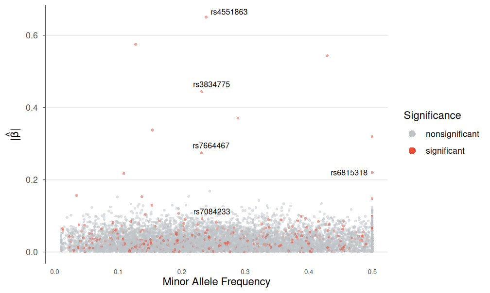

### Trumpet plot: power to detect

The trumpet plot overlays statistical-power contours on the
effect-versus-frequency relationship, showing which variants a study of
a given sample size is powered to detect. The contours flare toward rare
variants, giving the plot its shape; points below them fall in the
region the study is underpowered for.

``` r

trumpet_plot(example_gwas, n = 50000, label_top_n = 3)
```

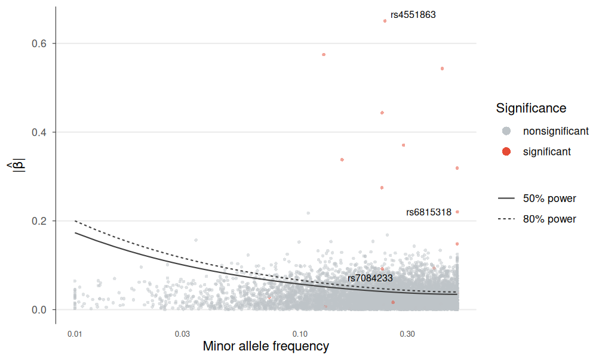

### Forest plots and cross-study comparison

A forest plot summarizes effect estimates with confidence intervals, for
example across cohorts or for a set of lead variants:

``` r

lead <- head(example_gwas[order(example_gwas$P), ], 10)
forest_plot(lead, order_by = "effect")
```

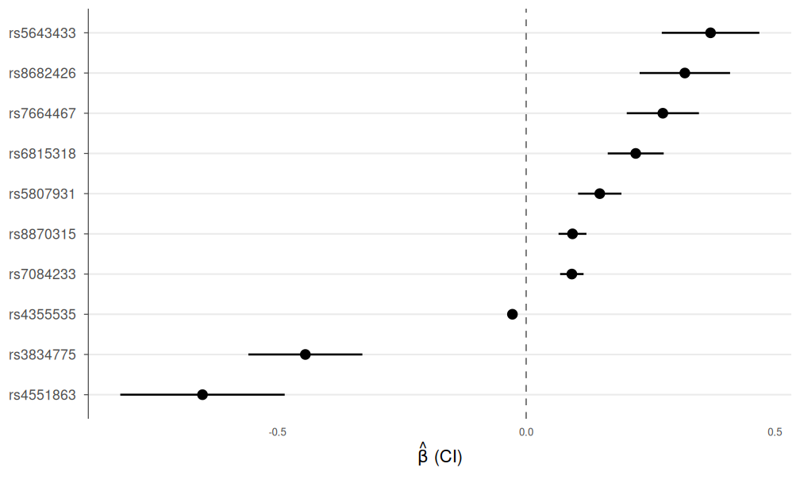

[`effect_compare_plot()`](https://bczech.github.io/ggwas/reference/effect_compare_plot.md)
scatters the effects of two studies on their shared variants to assess
replication and effect concordance:

``` r

set.seed(1)
replication <- example_gwas
replication$BETA <- replication$BETA + rnorm(nrow(replication), 0, 0.02)
effect_compare_plot(example_gwas, replication,
                    labels = c("Discovery", "Replication"), p_threshold = 1e-3)
```

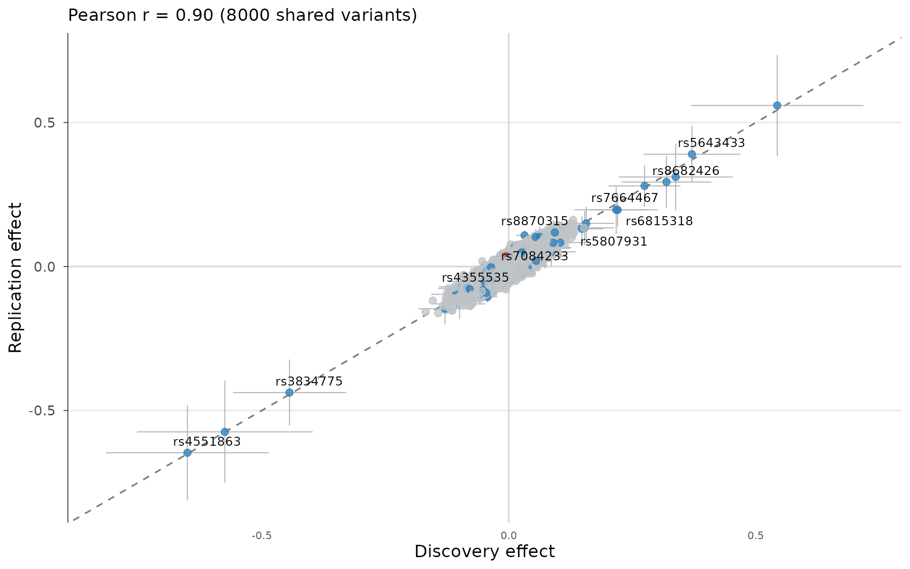

## Genome-wide density

### SNP density karyogram

Visualize how genotyped or imputed variants are distributed across the
genome. Regions with low coverage (centromeres, heterochromatin) appear
as gaps, while high-density regions stand out. Two rendering styles are
available.

**Heatmap style** bins variants and colors tiles by count, best for
large datasets:

Chromosome lengths are taken from the data unless a `Seqinfo` is given.
Here it comes from the same `TxDb` as the gene models:

``` r

snp_density(example_gwas, bin_size = 5e6, seqinfo = seqinfo(txdb))
```

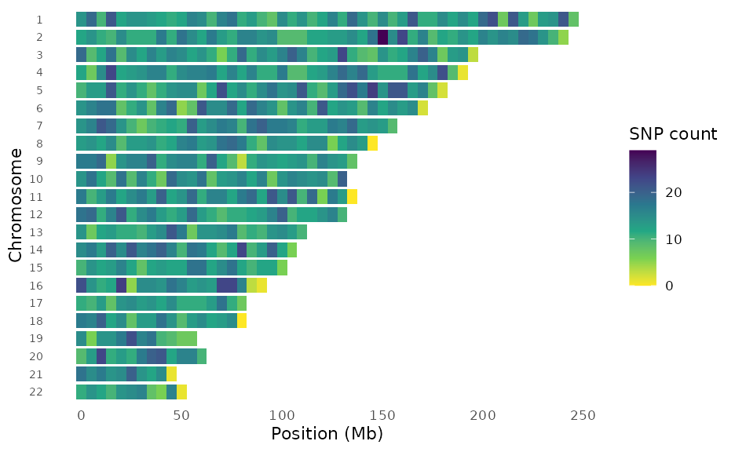

**Points style** draws individual variants on chromosome outlines, where
density is visible through natural clustering. Centromeres are marked
when their positions are given as a `GRanges`, for example the UCSC
“Centromeres” track imported with `rtracklayer::import()`. Here we use
the GRCh38 positions for chromosomes 1 to 3:

``` r

centromeres <- GRanges(c("chr1:122026460-124932724",
                         "chr2:92188146-94090557",
                         "chr3:90772459-93655574"))
snp_density(example_gwas, style = "points", seqinfo = seqinfo(txdb),
  centromeres = centromeres)
```

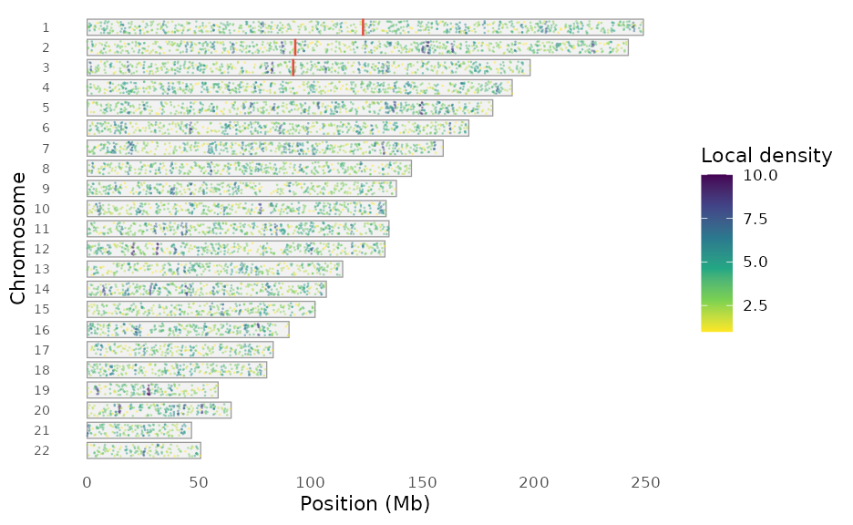

Points can be colored by local density, association significance, or
uniformly:

``` r

snp_density(example_gwas, style = "points",
  color_by = "significance", seqinfo = seqinfo(txdb))
```

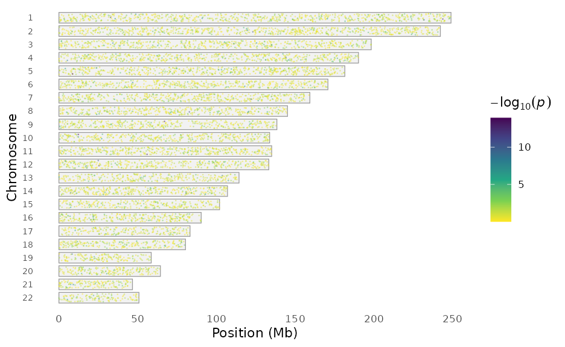

The `palette` argument works with both styles:

``` r

snp_density(example_gwas, bin_size = 5e6,
  palette = "magma", seqinfo = seqinfo(txdb))
```

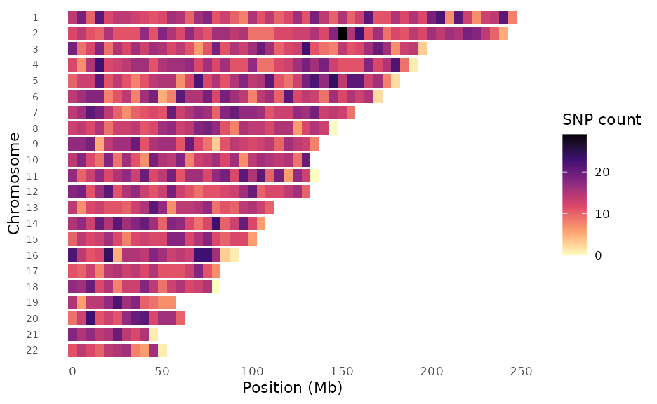

#### Other species

Any `Seqinfo` works, so other genomes need no extra data in ggwas. Take
it from the organism’s `TxDb`, `EnsDb` or `BSgenome` package, or let
*[GenomeInfoDb](https://bioconductor.org/packages/3.23/GenomeInfoDb)*
fetch it from UCSC or NCBI (this needs internet access, so the chunk is
not run here):

``` r

pig <- Seqinfo(genome = "susScr11")
snp_density(pig_gwas, seqinfo = pig)
```

### Density vs signal comparison

A critical quality-control visualization: compare genotyping density
(top track) against association signal strength (bottom track) for each
chromosome. This helps distinguish genuine signals from density
artifacts: if a region shows strong association AND high variant
density, the signal could be driven by uneven coverage rather than
biology.

``` r

density_signal_plot(example_gwas, bin_size = 5e6)
```

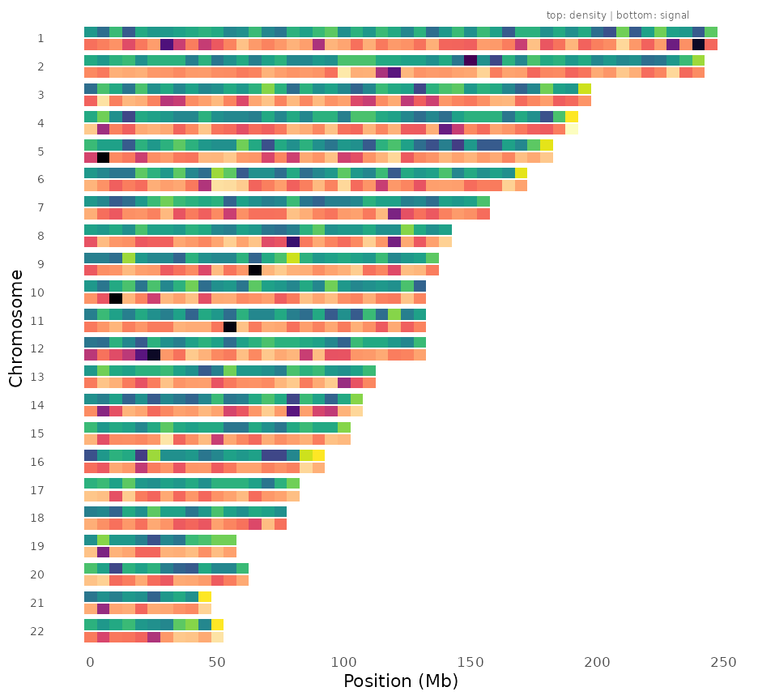

Regions where the bottom track lights up but the top track is uniform
are the most convincing signals.

## Themes, palettes, and presets

### Color palettes

ggwas ships with 14 palettes covering different use cases:
colorblind-safe defaults, journal-inspired schemes, and RColorBrewer
integrations:

``` r

gwas_palettes()
#>  [1] "default"       "colorblind"    "vibrant"       "pastel"       
#>  [5] "dark"          "nature"        "science"       "lancet"       
#>  [9] "nejm"          "aaas"          "brewer_set1"   "brewer_set2"  
#> [13] "brewer_paired" "brewer_dark2"
gwas_palette("nature", n = 5)
#> [1] "#E64B35" "#4DBBD5" "#00A087" "#3C5488" "#F39B7F"
```

Any palette can be passed directly to plot functions via the `colors`
argument. Use `gwas_palette(name, n = k)` to interpolate when you need a
specific number of colors (e.g., for multi-trait plots).

### Journal themes

Each journal has its own style requirements for figure fonts, sizes, and
axis formatting. Built-in themes handle this so you don’t need to
manually adjust parameters for each submission:

``` r

manhattan_plot(example_gwas, label_top_n = 3) + theme_nature()
```

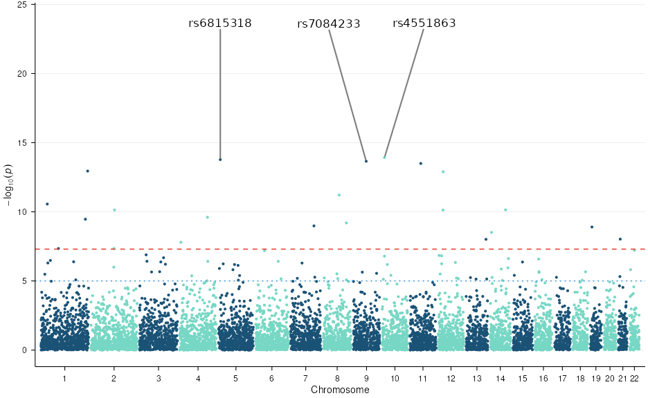

Available themes:
[`theme_nature()`](https://bczech.github.io/ggwas/reference/journal_themes.md),
[`theme_science()`](https://bczech.github.io/ggwas/reference/journal_themes.md),
[`theme_cell()`](https://bczech.github.io/ggwas/reference/journal_themes.md),
[`theme_plos()`](https://bczech.github.io/ggwas/reference/journal_themes.md),
[`theme_presentation()`](https://bczech.github.io/ggwas/reference/journal_themes.md),
[`theme_poster()`](https://bczech.github.io/ggwas/reference/journal_themes.md).

### Presets

A preset bundles together a theme, color palette, and appropriate point
sizes for a given context. This is the fastest way to switch between
exploratory analysis and publication-ready output:

``` r

p <- gwas_preset("publication")
manhattan_plot(example_gwas, colors = p$colors, point_size = p$point_size) + p$theme
```

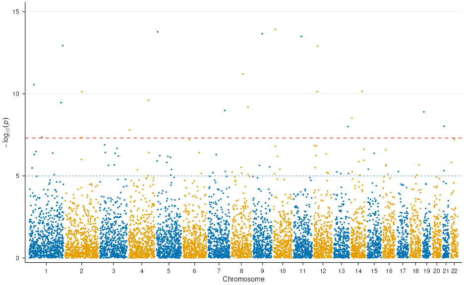

Available presets: `"publication"`, `"presentation"`, `"poster"`,
`"exploratory"`.

## Performance

For large datasets (common in imputed GWAS with 10-40M variants), ggwas
applies smart downsampling by default. The algorithm preserves all
significant and near-significant variants while spatially binning the
dense cloud of non-significant points. The resulting plot is visually
indistinguishable from plotting all points, but renders in seconds
rather than minutes:

``` r

manhattan_plot(large_gwas)                        # auto (target: 200k points)
manhattan_plot(large_gwas, downsample = FALSE)    # all points (slow)
manhattan_plot(large_gwas, downsample_n = 500000) # custom target
```

## Multi-panel figures

Since every ggwas function returns a standard ggplot object, you can
compose multi-panel figures using `patchwork` the same way you would
with any other ggplot:

``` r

library(patchwork)

p1 <- manhattan_plot(example_gwas, label_top_n = 3) +
  labs(tag = "A") + theme_nature()
p2 <- qq_plot(example_gwas) +
  labs(tag = "B") + theme_nature()
p3 <- volcano_plot(example_gwas, label_top_n = 5) +
  labs(tag = "C") + theme_nature()

p1 / (p2 | p3) + plot_layout(heights = c(2, 1))
```

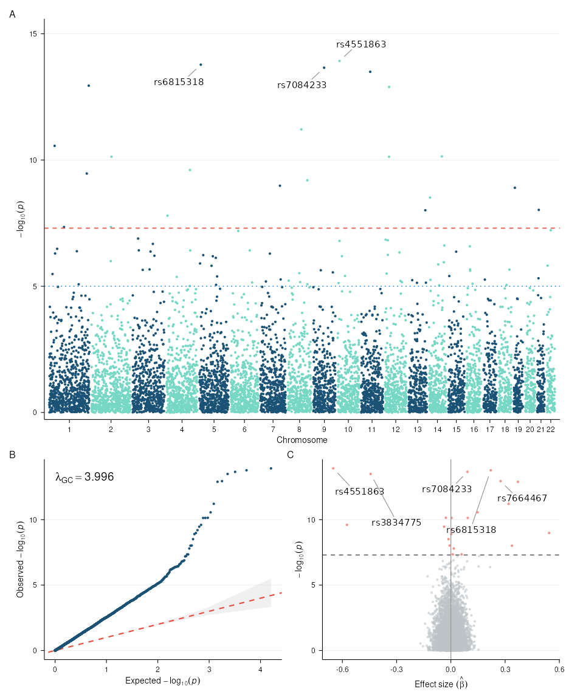

## Saving figures

Standard ggplot2 export with dimensions matching journal requirements:

``` r

fig <- manhattan_plot(example_gwas, label_top_n = 5) + theme_nature()

# Nature: single column (89 mm width)
ggsave("figure1.pdf", fig, width = 89, height = 55, units = "mm")

# Full-width figure (183 mm)
ggsave("figure1_wide.pdf", fig, width = 183, height = 80, units = "mm")

# High-res PNG for presentations
ggsave("figure1.png", fig, width = 10, height = 5, dpi = 300)
```

## Session info

``` r

sessionInfo()
#> R version 4.6.2 (2026-10-29)
#> Platform: x86_64-pc-linux-gnu
#> Running under: Ubuntu 26.04.1 LTS
#> 
#> Matrix products: default
#> BLAS:   /usr/lib/x86_64-linux-gnu/openblas-pthread/libblas.so.3 
#> LAPACK: /usr/lib/x86_64-linux-gnu/openblas-pthread/libopenblasp-r0.3.32.so;  LAPACK version 3.12.0
#> 
#> locale:
#>  [1] LC_CTYPE=C.UTF-8       LC_NUMERIC=C           LC_TIME=C.UTF-8       
#>  [4] LC_COLLATE=C.UTF-8     LC_MONETARY=C.UTF-8    LC_MESSAGES=C.UTF-8   
#>  [7] LC_PAPER=C.UTF-8       LC_NAME=C              LC_ADDRESS=C          
#> [10] LC_TELEPHONE=C         LC_MEASUREMENT=C.UTF-8 LC_IDENTIFICATION=C   
#> 
#> time zone: UTC
#> tzcode source: system (glibc)
#> 
#> attached base packages:
#> [1] stats4    stats     graphics  grDevices utils     datasets  methods  
#> [8] base     
#> 
#> other attached packages:
#>  [1] org.Hs.eg.db_3.23.1                     
#>  [2] TxDb.Hsapiens.UCSC.hg38.knownGene_3.22.0
#>  [3] GenomicFeatures_1.64.0                  
#>  [4] AnnotationDbi_1.74.0                    
#>  [5] Biobase_2.72.0                          
#>  [6] patchwork_1.3.2                         
#>  [7] rtracklayer_1.72.0                      
#>  [8] GenomeInfoDb_1.48.0                     
#>  [9] GenomicRanges_1.64.0                    
#> [10] Seqinfo_1.2.0                           
#> [11] IRanges_2.46.0                          
#> [12] S4Vectors_0.50.3                        
#> [13] BiocGenerics_0.58.1                     
#> [14] generics_0.1.4                          
#> [15] ggplot2_4.0.3                           
#> [16] ggwas_0.99.11                           
#> [17] BiocStyle_2.40.0                        
#> 
#> loaded via a namespace (and not attached):
#>  [1] viridisLite_0.4.3           farver_2.1.2               
#>  [3] blob_1.3.0                  Biostrings_2.80.2          
#>  [5] S7_0.2.2                    bitops_1.1-0               
#>  [7] fastmap_1.2.0               RCurl_1.98-1.20            
#>  [9] GenomicAlignments_1.48.0    XML_3.99-0.25              
#> [11] digest_0.6.39               lifecycle_1.0.5            
#> [13] KEGGREST_1.52.2             RSQLite_3.53.3             
#> [15] compiler_4.6.2              rlang_1.3.0                
#> [17] sass_0.4.10                 tools_4.6.2                
#> [19] yaml_2.3.12                 data.table_1.18.6.1        
#> [21] knitr_1.52                  S4Arrays_1.12.1            
#> [23] labeling_0.4.3              bit_4.6.0                  
#> [25] curl_8.1.0                  DelayedArray_0.38.2        
#> [27] RColorBrewer_1.1-3          abind_1.4-8                
#> [29] BiocParallel_1.46.0         withr_3.0.3                
#> [31] desc_1.4.3                  grid_4.6.2                 
#> [33] scales_1.4.0                SummarizedExperiment_1.42.0
#> [35] cli_3.6.6                   rmarkdown_2.32             
#> [37] crayon_1.5.3                ragg_1.5.2                 
#> [39] otel_0.3.0                  httr_1.4.9                 
#> [41] rjson_0.2.23                DBI_1.3.0                  
#> [43] cachem_1.1.0                parallel_4.6.2             
#> [45] BiocManager_1.30.27         XVector_0.52.0             
#> [47] restfulr_0.0.17             matrixStats_1.5.0          
#> [49] vctrs_0.7.3                 Matrix_1.7-6               
#> [51] jsonlite_2.0.0              bookdown_0.48              
#> [53] bit64_4.8.6                 ggrepel_0.9.8              
#> [55] systemfonts_1.3.2           jquerylib_0.1.4            
#> [57] glue_1.8.1                  pkgdown_2.2.1              
#> [59] codetools_0.2-20            gtable_0.3.6               
#> [61] BiocIO_1.22.0               UCSC.utils_1.8.0           
#> [63] htmltools_0.5.9             R6_2.6.1                   
#> [65] textshaping_1.0.5           evaluate_1.0.5             
#> [67] lattice_0.23-1              png_0.1-9                  
#> [69] Rsamtools_2.28.0            cigarillo_1.2.1            
#> [71] memoise_2.0.1               bslib_0.12.0               
#> [73] Rcpp_1.1.2                  gridExtra_2.3.1            
#> [75] SparseArray_1.12.3          xfun_0.62                  
#> [77] pkgconfig_2.0.3             fs_2.1.0                   
#> [79] MatrixGenerics_1.24.0
```
